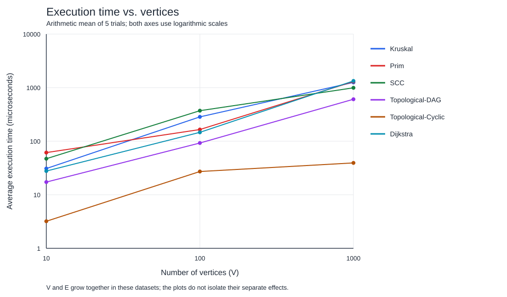
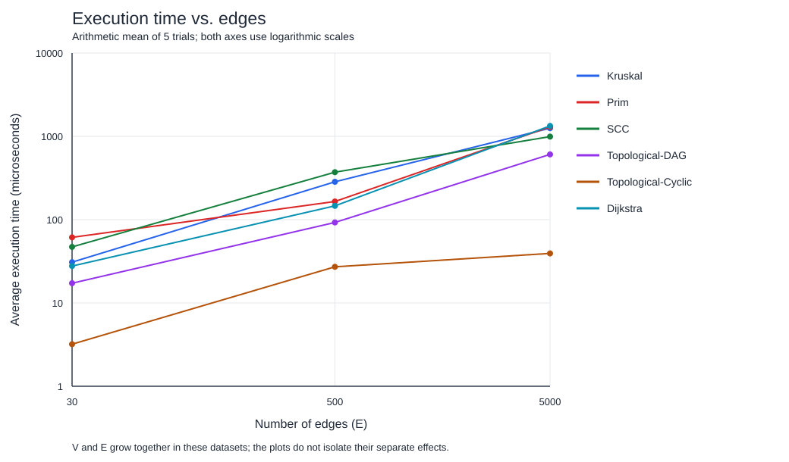

# Smart City Infrastructure and Route Planning

Assignment 3 for Design and Analysis of Algorithms.

## Overview

This Java application models city districts as vertices and roads as edges. A weight represents a construction cost for infrastructure planning or a distance for route planning. Vertices are numbered from `0` to `V - 1`.

The application implements:

- Disjoint Set Union (DSU) with path compression and union by rank.
- Kruskal and Prim for a minimum spanning tree (MST).
- Kosaraju for strongly connected components (SCCs).
- Kahn's algorithm for topological ordering and cycle detection.
- Dijkstra for shortest distances and routes from a selected district.

`Graph` uses adjacency lists and an edge list. An undirected road appears once in the edge list and in both endpoint adjacency lists. Directed roads appear only in their given direction. The graph class allows parallel edges and self-loops; the experiment generators produce simple graphs without either.

## Build and Run

Requirements: JDK 17 or later and Maven 3. Java 17 is the compilation target. JUnit is needed only for tests; the application and plots use the Java standard library.

From the repository root:

```text
mvn clean test
mvn compile exec:java
mvn compile exec:java "-Dexec.args=demo 2"
mvn compile exec:java -Dexec.args=experiments
```

The default run is a demonstration. It prints the MST edges and weight, a valid dependency order, detected cycles, SCCs, and shortest routes. In the default example, both MST weights are `13`. From source `0`, district `5` has distance `13` and district `6` is unreachable. The source can be selected with `demo 0` through `demo 6`.

The `experiments` command regenerates the CSV files, tables, and both SVG plots in `results/`. Run it from the repository root so the output goes to the right folder. It replaces the previous experimental files. Timing values can change between runs.

### IntelliJ IDEA

1. Open the repository folder containing `pom.xml` and load it as a Maven project.
2. Select JDK 17 or later as the project SDK and Maven runner JDK.
3. Run `app.Main` with no arguments for the demonstration.
4. To run experiments, set the program arguments to `experiments` and the working directory to the repository root.
5. Run tests from the `tests` folder or use the Maven goal `test`.

In IntelliJ's Maven goal field, enter `compile exec:java -Dexec.args=experiments` without the initial `mvn`. Compiling alone does not run the application.

## Implementation

| Location | Responsibility |
|---|---|
| `src/graph/` | Edges, adjacency lists, and reproducible graph generation |
| `src/dsu/` | Disjoint sets with parent and rank arrays |
| `src/mst/` | Kruskal, Prim, and MST results |
| `src/connectivity/` | SCCs and topological ordering |
| `src/shortestpath/` | Dijkstra, distances, and route reconstruction |
| `src/metrics/` | Operation counters |
| `src/experiment/` | Measurements, CSV tables, and SVG plots |
| `src/app/` | Program entry point and city examples |
| `tests/checks/` | JUnit correctness tests |
| `results/tables/` | Raw trials, averages, environment details, and saved output |
| `results/plots/` | The two required plots |

### DSU and MST

`find` follows parent links to a set representative and then points the visited elements directly to that representative. `union` joins the roots and attaches the tree with the smaller rank to the larger one. If ranks are equal, the chosen root's rank increases.

Kruskal sorts a copy of the edges by weight. It accepts an edge only when DSU says its endpoints belong to different sets. It stops when it has `V - 1` edges or runs out of edges.

Prim starts from an unvisited vertex and puts candidate edges in a Java `PriorityQueue`. It repeatedly accepts the cheapest edge leading to an unvisited vertex. Old queue entries leading to already visited vertices are skipped. It restarts from another unvisited vertex when needed.

Both methods report the total weight and whether the whole graph is connected. On a disconnected graph they return a minimum spanning forest with `connected=false`. A single vertex is connected and has MST weight zero. Directed input is rejected. Equal weights may produce different valid trees with the same total weight.

### SCCs and topological ordering

Kosaraju first visits the original graph and records DFS finishing order. It then reverses the edges and visits vertices in reverse finishing order. Each visit in this second pass produces one SCC. Both passes use an explicit stack to avoid depending on Java's recursion limit.

Kahn's algorithm counts incoming edges and processes vertices with indegree zero using a queue. If it processes every vertex, the returned order is valid. Otherwise, the graph contains a cycle and the result has `acyclic=false` and an empty order. These two algorithms require directed input.

### Shortest paths

Dijkstra starts with distance zero at the selected source and infinity elsewhere. A priority queue chooses the next smallest tentative distance. Relaxing an edge improves a neighbor's distance when a shorter route is found. The queue may hold several entries for one vertex; stale entries are skipped.

Distances and MST totals use `long` to avoid overflow when several `int` weights are added. Previous-vertex links reconstruct routes. An unreachable vertex has distance `Long.MAX_VALUE` and an empty path; the demonstration prints `unreachable`.

Dijkstra rejects any negative edge weight, including in an unreachable component. Its usual guarantee depends on non-negative weights: after reaching the smallest unsettled distance, a later route cannot make it smaller. A negative edge breaks that reasoning. For example, edges `0 -> 1` with weight `2`, `0 -> 2` with weight `5`, and `2 -> 1` with weight `-10` make the actual distance to `1` equal to `-5`. A standard settled-vertex Dijkstra can finalize vertex `1` at distance `2` too early. Bellman-Ford is a suitable alternative when negative edges are allowed; reachable negative cycles require separate handling.

## Complexity Analysis

`V` is the number of vertices and `E` is the number of stored logical edges. The table gives additional space beyond the input graph. Adjacency lists themselves require `O(V + E)` space.

| Algorithm | Time | Additional space |
|---|---|---|
| DSU initialization | `O(V)` | `O(V)` |
| DSU find / union | `O(alpha(V))` amortized per operation | `O(log V)` temporary recursion stack; parent/rank arrays use `O(V)` |
| Kruskal | `O(V + E log(E + 1) + E alpha(V))` | `O(V + E)` |
| Prim with a lazy edge heap | `O(V + E log(E + 1))` | `O(V + E)` |
| Kosaraju SCC | `O(V + E)` | `O(V + E)` |
| Kahn topological ordering | `O(V + E)` | `O(V)` |
| Dijkstra with a lazy binary heap | `O(V + E log(E + 1))` | `O(V + E)` |

`alpha(V)` is the inverse Ackermann function, which grows very slowly. The DSU bound is an average over a sequence of operations, not a promise that every individual call takes constant time. Union by rank keeps the uncompressed tree height at most `O(log V)`. Path compression shortens later searches. Rank is a bound used for linking roots, not the current exact height after compression.

Kruskal spends most of its time sorting `E` edges, followed by DSU operations. Prim's queue can contain up to `O(E)` candidate edges, so this implementation uses `log E` heap bounds rather than assuming a queue of only `V` vertices. Dijkstra also uses lazy entries instead of a decrease-key operation and may store `O(E)` entries. For simple connected graphs, `E <= V(V - 1)`, so `log E = O(log V)` and the usual `O(E log V)` bounds apply. For general simple graphs, `O((V + E) log V)` is a common upper bound for heap-based Dijkstra and Prim.

Kosaraju scans all vertices and edges a constant number of times. Kahn also scans them, although cycle detection can stop before traversing every adjacency list. Dijkstra checks all weights first, then examines edges from reachable vertices. More edges increase edge scans and usually increase heap work; more vertices increase array initialization, traversal, and possible route lengths. Reconstructing one route takes `O(L)` time and space for a path of `L` vertices and is outside the benchmark.

## Experimental Setup

| Configuration | Vertices | Edges |
|---|---:|---:|
| Small | 10 | 30 |
| Medium | 100 | 500 |
| Large | 1,000 | 5,000 |

The base random seed is `20261024`. For each size, the connected graph uses seed `base + V`, the DAG uses `base + V + 1`, and the directed cyclic graph uses `base + V + 2`. Java's `Random` generates edge weights from `1` to `100`, so duplicate weights are expected.

- **Connected undirected graph:** first connect each vertex `i > 0` to a random earlier vertex. This forms a spanning tree. Add unique random undirected edges until the exact edge count is reached. Kruskal, Prim, and Dijkstra use the same graph. This generation method is reproducible but is not a uniform sample of all connected graphs.
- **DAG:** add unique edges only from a smaller vertex ID to a larger ID. IDs therefore give one possible topological order, and cycles cannot occur.
- **Directed cyclic graph:** begin with the cycle `0 -> 1 -> ... -> V - 1 -> 0`, then add unique random directed edges. The whole graph is one SCC and every vertex has positive indegree. SCC and the cyclic topological case use this graph. Tests also cover graphs with several SCCs.

Each of the six algorithm cases runs at every size. There are three warm-up runs followed by **five measured trials** on the same unchanged input. Each call starts with fresh arrays, queues, and counters. Graph generation, file writing, plotting, result checking, and path printing are outside the timed interval. Algorithm initialization, sorting, weight validation, and operation counting are included. Time uses `System.nanoTime()`; the reported value is the arithmetic mean, not the median.

The saved run used Microsoft OpenJDK `17.0.20.1`, Windows 11, an AMD Ryzen 7 7840HS, about 16 GB RAM, and 16 logical processors. See [environment details](results/tables/environment.txt).

### What the operation counters mean

| Counter | Definition |
|---|---|
| Edge examinations | An algorithm inspects an edge in a loop. Kruskal counts candidate edges after sorting; Prim counts adjacency scans; SCC includes the first DFS, transpose construction, and second DFS; Kahn includes indegree construction and outgoing scans; Dijkstra includes weight validation and reachable adjacency scans. |
| Comparisons | Weight comparisons made by Kruskal's sort, or priority comparisons made by Prim's and Dijkstra's heaps. Other conditional checks are not counted. |
| Find calls | Every DSU `find` invocation, including recursive parent visits during compression. |
| Union calls | Every attempted DSU union, including attempts that find both vertices already connected. |

These are different kinds of work, so their numeric values are not interchangeable. A zero in a comparison column means that no sort/heap comparator was used, not that the algorithm did no work.

## Results

Average execution times in **microseconds** (`1 microsecond = 1,000 ns`):

| Algorithm | V=10, E=30 | V=100, E=500 | V=1,000, E=5,000 |
|---|---:|---:|---:|
| Kruskal | 30.880 | 284.540 | 1,252.480 |
| Prim | 61.300 | 165.160 | 1,299.640 |
| SCC | 47.080 | 371.220 | 992.360 |
| Topological, DAG | 17.260 | 92.500 | 607.000 |
| Topological, cyclic | 3.200 | 27.160 | 39.320 |
| Dijkstra | 27.720 | 146.380 | 1,333.580 |

Average operation counts per trial:

| Algorithm | V | E | Edge examinations | Comparisons | Find calls | Union calls |
|---|---:|---:|---:|---:|---:|---:|
| Kruskal | 10 | 30 | 18 | 112 | 60 | 18 |
| Prim | 10 | 30 | 60 | 201 | 0 | 0 |
| SCC | 10 | 30 | 90 | 0 | 0 | 0 |
| Topological, DAG | 10 | 30 | 60 | 0 | 0 | 0 |
| Topological, cyclic | 10 | 30 | 30 | 0 | 0 | 0 |
| Dijkstra | 10 | 30 | 90 | 51 | 0 | 0 |
| Kruskal | 100 | 500 | 215 | 3,838 | 803 | 215 |
| Prim | 100 | 500 | 1,000 | 7,623 | 0 | 0 |
| SCC | 100 | 500 | 1,500 | 0 | 0 | 0 |
| Topological, DAG | 100 | 500 | 1,000 | 0 | 0 | 0 |
| Topological, cyclic | 100 | 500 | 500 | 0 | 0 | 0 |
| Dijkstra | 100 | 500 | 1,500 | 2,547 | 0 | 0 |
| Kruskal | 1,000 | 5,000 | 3,216 | 50,417 | 12,330 | 3,216 |
| Prim | 1,000 | 5,000 | 10,000 | 110,972 | 0 | 0 |
| SCC | 1,000 | 5,000 | 15,000 | 0 | 0 | 0 |
| Topological, DAG | 1,000 | 5,000 | 10,000 | 0 | 0 | 0 |
| Topological, cyclic | 1,000 | 5,000 | 5,000 | 0 | 0 | 0 |
| Dijkstra | 1,000 | 5,000 | 15,000 | 35,509 | 0 | 0 |

MST weight agreement:

| V | E | Kruskal weight | Prim weight | Connected |
|---|---:|---:|---:|---|
| 10 | 30 | 236 | 236 | Yes |
| 100 | 500 | 1,388 | 1,388 | Yes |
| 1,000 | 5,000 | 12,700 | 12,700 | Yes |





Both axes use logarithmic scales. Each point is the mean of five measurements. Vertices and edges grow together in these three datasets, so the plots do not independently measure the effect of changing only `V` or only `E`.

All [90 raw trials](results/tables/trials.csv), [18 summary rows](results/tables/summary.csv), and [generated Markdown tables](results/tables/results.md) are included. The `result_signature` column records MST weight, SCC count, topological order size (`-1` for a cycle), or `sum((vertex + 1) * distance)` for Dijkstra. It checks consistency between repeated runs; the independent correctness tests provide stronger checks.

Running experiments again refreshes these files and plots. The tables above describe the saved run and should be updated if a new run is used for the report.

## Comparison and Discussion

**Kruskal vs. Prim.** Both methods produced the same MST weight at each size. In this run Kruskal was faster on the small graph, Prim was faster on the medium graph, and their large-graph times were close. This is not evidence that one always wins. Kruskal sorts all edges, while Prim adds and removes heap entries. At `V=1,000`, their comparator counts were `50,417` and `110,972`. Kruskal examined only `3,216` candidate edges before the tree was complete, but its sorting work still covered all `5,000` edges. Prim scanned all `10,000` adjacency entries.

**DSU improvements.** Rank prevents repeatedly attaching a large tree below a smaller tree. Compression makes later finds jump closer to the root. At the large size, `3,216` union attempts caused `12,330` find invocations including recursive parent visits. The DSU test also builds a tree of several levels and verifies that a repeated find uses fewer parent visits after compression. This demonstrates compression; it is not a timing comparison with an unoptimized DSU.

**SCC scaling.** SCC time rose from `47.080` to `371.220` to `992.360` microseconds. Its edge examinations were exactly `3E`: `90`, `1,500`, and `15,000`. This matches the constant number of edge scans in `O(V + E)`, although measured time is not proportional at every step because Java execution costs change after warm-up.

**Topological ordering.** The DAG cases returned valid complete orders; every directed cyclic case was rejected. In the cyclic generator every vertex already has an incoming edge, so the initial zero-indegree queue is empty. The algorithm counts indegrees and reports the cycle without processing outgoing adjacency lists. That explains `E` examinations instead of the DAG's `2E`, and the shorter times. Other cyclic graphs can process an acyclic portion first.

**Dijkstra scaling.** Average time increased from `27.720` to `146.380` to `1,333.580` microseconds. All vertices were reachable in the connected benchmark inputs. Edge examinations were `3E`: one pass over the logical edges for weight validation and `2E` adjacency entries for the undirected search. Heap comparisons increased from `51` to `2,547` to `35,509`, showing the extra queue work beyond edge scanning.

**Theory and measurements.** The operation counts fit the expected traversal and heap behavior. They do not prove asymptotic complexity. Five trials are a small sample, especially for short runs. JVM compilation, garbage collection, cache behavior, object allocation, operating-system scheduling, and the cost of instrumentation can change the times. Reproducibility means the input graphs and procedure can be repeated, not that nanosecond values will be identical on another run or computer. Testing more seeds and varying edge density at a fixed vertex count would strengthen the comparison.

## Testing

The saved test run passed **28 JUnit test methods**, with **0 failures, 0 errors, and 0 skipped tests**. See [saved test results](results/tables/test-results.txt).

| Area | Correctness checks |
|---|---|
| DSU | Set merging, repeated unions, invalid elements, one element, and reduced parent visits after compression |
| MST | Known costs, disconnected forests, isolated vertices, single vertex, duplicate weights, several valid MSTs, parallel edges, self-loops, and negative costs |
| Random MSTs | 100 connected graphs with five vertices; compare both algorithms against exhaustive spanning-tree search and check that returned edges form a tree |
| Topological ordering | Check all edges against vertex positions on a disconnected DAG and 100 random DAGs; detect cycles and self-loops |
| SCC | Known components, an isolated vertex, a single vertex, a 1,000-vertex chain, and 100 random directed graphs checked against mutual reachability |
| SCC membership | Every vertex must occur exactly once; two vertices share an SCC exactly when each can reach the other |
| Dijkstra | Known distances and complete paths, unreachable vertices, another source, zero weights, duplicate/parallel edges, self-loops, single vertex, long distances, and rejection of negative weights |
| Random shortest paths | 100 directed/undirected graphs from every source; compare distances with Floyd-Warshall and verify the edges and cost of each reported path |
| Generators | Exact required vertex/edge counts, no duplicate edges or self-loops, fixed-seed reproducibility, connectivity, guaranteed cycles/DAGs, and invalid configurations |

The independent reference methods are used only in tests. Experiments use the required graph algorithms. Example output is saved in [demo-output.txt](results/tables/demo-output.txt), and the measured console table is in [experiment-output.txt](results/tables/experiment-output.txt).

## GitHub Workflow

Development uses `main` and three feature branches: `codex/graph-algorithms`, `codex/experiments`, and `codex/report`. Meaningful commits record the graph model and DSU, MST algorithms, connectivity algorithms, shortest paths, correctness tests, reproducible graph generation, measurements, saved results, and this report. Feature branches are merged into `main` with merge commits so the development stages remain visible.

The repository contains the Java source, tests, measured data, plots, and this README report. Submit the public repository link in Moodle.

## Conclusion

Use Kruskal or Prim to connect districts at minimum total construction cost. Both solve the same undirected MST problem; the best runtime depends on the data and implementation. DSU makes Kruskal's connectivity checks efficient.

Use SCCs to group locations that can reach each other through directed roads. Use topological ordering for service dependencies only when the graph is acyclic. Use Dijkstra to plan routes from one district when all distances are non-negative. These algorithms solve different planning tasks, so choosing the right one starts with the meaning and direction of the graph's edges.
